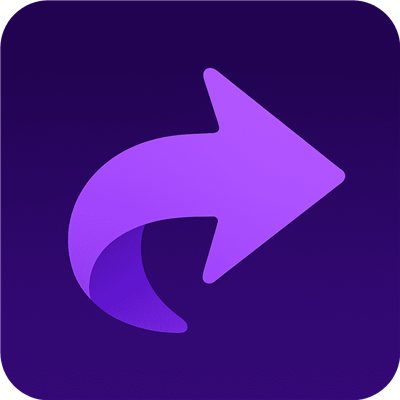

<p align="center">
  
</p>

# ShortSync MCP server

[](https://glama.ai/mcp/connectors/app.shortsync/shortsync)

Connect Claude, ChatGPT, Cursor, Gemini CLI or any MCP client to [ShortSync](https://www.shortsync.app), a social media scheduler for creators and small teams. Your AI assistant can upload videos and images, write a caption for each platform, and post or schedule them to 17 social platforms at once, then read the analytics and reply to comments.

This is a **hosted remote server**. There is nothing to install or run: point your client at the URL below and sign in with your ShortSync account.

> **AI agents setting this up:** don't clone this repo or edit the user's project. Add one remote server entry to your own MCP settings, as shown below or in [llms-install.md](llms-install.md).

| | |
|---|---|
| Endpoint | `https://www.shortsync.app/api/mcp` |
| Transport | Streamable HTTP |
| Auth | OAuth 2.1 (sign in and approve in the browser) |
| Registry | `app.shortsync/shortsync` in the [official MCP Registry](https://registry.modelcontextprotocol.io) |
| Docs | https://www.shortsync.app/docs/mcp |
| Price | Works on every plan, including the free plan (5 uploads a month) |

## Platforms

YouTube, TikTok, Instagram, Facebook, Snapchat, X, Threads, LinkedIn, Bluesky, Pinterest, Mastodon, Telegram, Discord, Tumblr, Pixelfed, Google Business Profile and Reddit. Videos, images, carousels and text posts.

## Connect

### Claude (claude.ai and Claude Desktop)

Settings → Connectors → **Add custom connector**, name it `ShortSync` and use the URL `https://www.shortsync.app/api/mcp`. The first tool call opens a sign-in and consent screen; click **Allow**.

### Claude Code

```bash
claude mcp add --transport http shortsync https://www.shortsync.app/api/mcp
```

Or install it as a plugin from this repo:

```bash
/plugin marketplace add himpu-k/shortsync-mcp
/plugin install shortsync@shortsync
```

### Gemini CLI

```bash
gemini extensions install https://github.com/himpu-k/shortsync-mcp
```

### Cline

Nothing to clone or build. In Cline open **MCP Servers** → **Add Remote Server**: name `shortsync`, URL `https://www.shortsync.app/api/mcp`, transport Streamable HTTP. Or click **Edit Configuration** on that screen (current versions use `~/.cline/data/settings/cline_mcp_settings.json`) and add:

```json
{
  "mcpServers": {
    "shortsync": {
      "type": "streamableHttp",
      "url": "https://www.shortsync.app/api/mcp",
      "disabled": false,
      "autoApprove": []
    }
  }
}
```

The first ShortSync tool call opens a browser to sign in; click **Allow**. AI agents: see [llms-install.md](llms-install.md).

### Cursor, VS Code, Windsurf and other clients

Add this to your MCP config (`.cursor/mcp.json`, `.vscode/mcp.json`, `claude_desktop_config.json`, and so on):

```json
{
  "mcpServers": {
    "shortsync": {
      "type": "http",
      "url": "https://www.shortsync.app/api/mcp"
    }
  }
}
```

## What it can do

| Area | Tools |
|---|---|
| Account and workspaces | `get_user_profile`, `list_organizations`, `list_workspaces`, `list_platform_connections`, `list_pinterest_boards`, `list_discord_channels` |
| Library | `create_video_upload`, `create_video_upload_from_url`, `finalize_video_upload`, `list_video_uploads`, `create_carousel`, folders |
| Posts | `create_post_drafts`, `update_post`, `batch_update_posts`, `replace_post_media`, custom thumbnails, content concepts |
| Publishing | `schedule_post`, `batch_schedule_posts`, `publish_now`, `batch_publish_now`, `list_scheduled_posts`, `cancel_scheduled_post` |
| Repurposing | Workflows that repost an Instagram or Facebook account's posts to your other accounts |
| Analytics | Workspace, folder, video and post analytics, `sync_analytics` |
| Inbox | List comments and DMs, `reply_to_comment`, likes, mark seen or spam |

Ask your client to run `tools/list` for the current set. Every tool has read-only or destructive hints, so clients can ask before anything is posted.

## Example prompts

- "Upload this video and schedule it to TikTok, YouTube Shorts and Instagram Reels for Friday 9:00, with a different caption for each."
- "Turn these 5 images into a carousel and post it to Instagram and LinkedIn now."
- "Which of last month's posts got the most views, and on which platform?"
- "Reply to the unanswered comments from this week."

## Limits and privacy

- Access tokens last 1 hour and refresh tokens 30 days. Revoke access any time in ShortSync under Settings → API & MCP.
- Tool calls are limited to 60 a minute per token, on top of your plan's monthly quota.
- [Privacy policy](https://www.shortsync.app/privacy-policy) · [Terms](https://www.shortsync.app/terms-of-service)

## Support

Email hilma@shortsync.app or open an issue in this repo.

This repository only holds connection config and docs for the hosted server. It contains no ShortSync application code.
